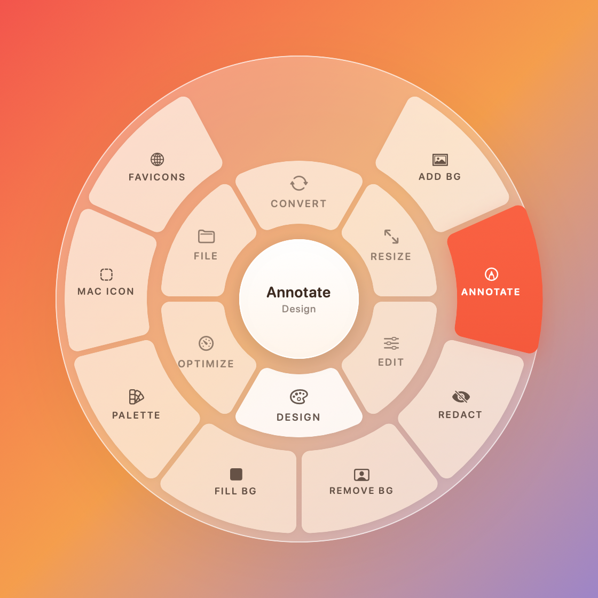

# Orbit

A ring menu for files on macOS. Pick up a file in Finder and hold it for a moment. A ring opens around the cursor with the conversions and edits that fit that file. Drop it on a petal and the result is saved next to the original.

Everything runs on your Mac. No uploads, no accounts.



## What it does

The inner ring holds categories, the outer ring the actions of the category under the cursor. What you see depends on the file type.

| File | Actions |
|---|---|
| Image | Convert to PNG, JPG, HEIC, WebP, TIFF, GIF, BMP, PDF · resize by percent, long side or 1:1 / 4:5 / 9:16 / 16:9 · crop, rotate, flip, trim borders, enhance, mono, sharpen · add background, annotate, redact, remove background, palette, macOS icon, favicon set · compress, shrink under 1 MB / 300 KB, strip EXIF, copy text (OCR), edit metadata |
| PDF | Convert to PNG, JPG, TXT, DOCX, RTF, HTML, OCR · merge, split, rotate, reverse, cover image, delete or extract pages · lock, unlock, watermark · compress, strip or edit metadata |
| Document (TXT, RTF, DOCX, DOC, ODT, HTML, MD) | Convert between them and to PDF · QR code from a text or link |
| Video | MP4, MOV, WebM, GIF, first frame · auto crop black bars, 9:16, 1:1, 720p, 1080p, rotate, trim · extract MP3 / WAV, mute, transcribe, burn subtitles · compress, web ready, 2x speed, contact sheet |
| Audio | MP3, M4A, WAV, FLAC, AIFF, OGG · normalize, trim, trim silence, transcribe, mono, fade |
| Any file | ZIP, batch rename (`{name}`, `{n}`, `{date}`) · unzip for `.zip` |

Outputs never overwrite anything: `photo.jpg` becomes `photo 50%.jpg`, then `photo 50% 2.jpg` and so on. The menu bar item has **Undo**, which moves the last outputs to the Trash or reverts the last rename.

## Opening the ring

- **Hold and nudge:** press a file in Finder or on the desktop, move it slightly and hold for a quarter second. A fast drag elsewhere is a normal file move and does not open the ring.
- **Shift while dragging:** opens it at once.
- **⌥Space:** opens the ring for the current Finder selection. The first use asks for permission to control Finder.

The ring opens on the category you used last for that file type.

## Install

### Download

1. Download the zip from the [latest release](https://github.com/onder007/orbit/releases/latest) and unzip it. It needs macOS 14 or later and runs on Apple silicon only.
2. Move Orbit.app to `~/Applications` or `/Applications`.
3. Orbit is ad-hoc signed and not notarized, so macOS blocks the first open. Open it once, then go to System Settings → Privacy & Security and choose Open Anyway. In Terminal instead, with the path you moved it to: `xattr -dr com.apple.quarantine ~/Applications/Orbit.app`

### Build from source

Requires macOS 14 or later and the Swift toolchain (Xcode Command Line Tools are enough).

```bash
git clone https://github.com/onder007/orbit.git
cd orbit
./scripts/bundle.sh
mkdir -p ~/Applications && cp -R Orbit.app ~/Applications/
open ~/Applications/Orbit.app
```

Orbit adds itself to Login Items on first launch.

Video and audio actions except Transcribe use [ffmpeg](https://ffmpeg.org), as does image to WebP. Transcribe on a video uses it to pull out the audio when it is installed. Orbit does not bundle it and looks in `~/.local/bin`, `/opt/homebrew/bin` and `/usr/local/bin`. Contact sheet also needs ffprobe in the same folder. Without ffmpeg the actions that use it show an error when used.

## Permissions

| Feature | Permission |
|---|---|
| ⌥Space | Automation → Finder (asked on first use) |
| Transcribe | Speech Recognition (asked on first use). Recognition runs on the device when the language supports it. |
| Hold and nudge, Shift drag | None. Orbit watches the drag pasteboard, not your keyboard or mouse. |

## Command line

```bash
Orbit.app/Contents/MacOS/Orbit --run to-webp photo.png    # run one action by id
Orbit.app/Contents/MacOS/Orbit --selftest                 # build fixtures and test every engine
```

Action ids are in `Sources/Orbit/Catalog.swift`.

## Limitations

- Transcription tries the system language and English and keeps the more confident result; other languages need the system language set to them.
- Burn subtitles needs `name.srt` next to `name.mp4`.
- PDF to DOCX, RTF and HTML carries the text only, not the layout.
- Remove background needs a clear subject; it uses the Vision framework.

## Development

```bash
swift build
.build/debug/Orbit --selftest
.build/debug/Orbit --preview photo.png ring.png 1 3   # render the ring for a file: segment 1, action 3 highlighted
```

```
Sources/Orbit/
  main.swift      app, ring window, triggers (drag watcher, ⌥Space)
  RingView.swift  ring layout, hit testing, look
  Catalog.swift   which actions each file type gets
  Engines.swift   images, PDF, documents, ffmpeg
  Extras.swift    OCR, background removal, PDF security, transcription, icons, files
  Editors.swift   crop, background, annotate, redact, metadata windows
  Support.swift   prompts, undo, progress
  Dev.swift       --preview and --selftest
```

## License

MIT, see [LICENSE](LICENSE).
